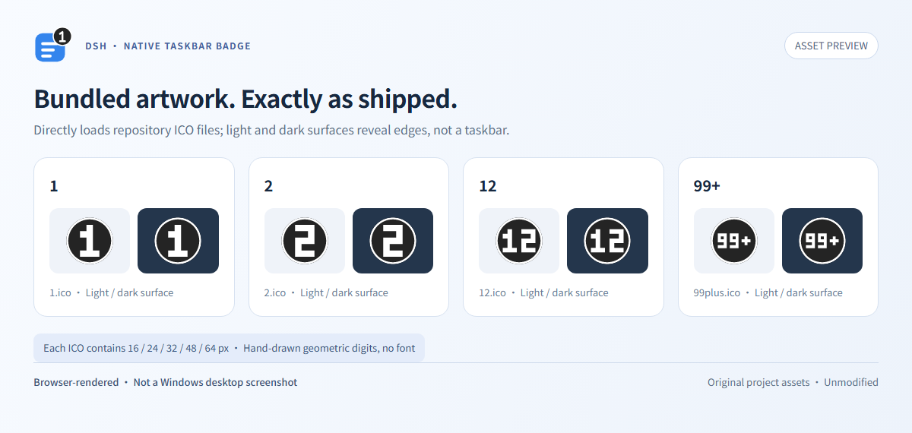
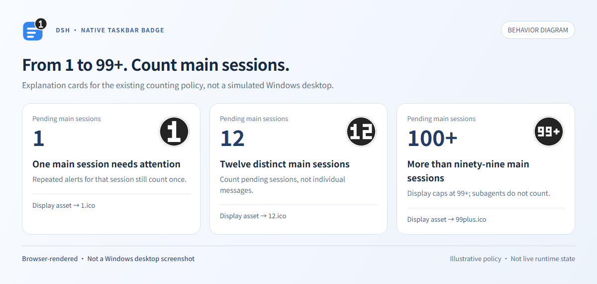
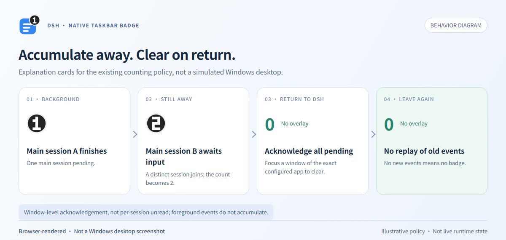

# DSH Native Taskbar Badge

[简体中文](./README.zh-CN.md) · [MIT](./LICENSE)

A quiet, Windows-native numeric taskbar badge for DeepSeek Harness Desktop.

## Keep working; check back when needed

Run several main sessions, switch to your editor, and see when DSH needs attention.

- **Quiet by design:** no toast, sound or focus stealing.
- **One session, one count:** completion, errors and requests for your input, deduplicated.
- **Return to clear:** focus DSH to acknowledge the whole pending count.
- **Independent plugin:** no ASAR patching or application-identity changes.



*Browser-rendered asset previews and behavior diagrams; not Windows desktop acceptance screenshots.*

## What the number means

In the background, each main session counts once when it completes, fails, is blocked, reaches its output limit, waits for approval or calls `ask_user_question`. Subagents do not count.



The display runs from `1` to `99`, then `99+`. Focusing any window of the exact configured DSH executable clears all pending sessions: **window-level acknowledgement, not per-session unread tracking**. Foreground events do not accumulate; leaving again or restarting does not replay history.



Cancellation and restored history do not notify; completed intermediate rounds of an active goal are filtered by default. See [counting details](docs/behavior.md).

## Requirements

**Windows 10/11**, Explorer and a visible DSH taskbar button; **Python 3.10+** for Windows; **Node 22+**; DSH **`>=0.2.1-rc.2 <0.3.0`** with official `subprocess` and `sessionProjections` services. See [compatibility](docs/operations.md).

## Install from source

Clone or download this repository, then open PowerShell in its directory. Use the official CLI shipped with **your current DSH Desktop installation**:

```powershell
$DshCli = Read-Host 'Full path to resources\runtime\cli\bin\dsh.cmd in your DSH installation'
$Project = (Resolve-Path .).Path
& $DshCli plugin --profile desktop add --ignore-scripts $Project
```

Keep the source directory in place if the CLI creates a local link. Disable any older badge plugin before enabling this one. [Install, disable and uninstall](docs/operations.md).

## Settings

**Simplified Chinese is the default and fallback.** Choose `language: en` for English; only explicit `auto` follows environment language.

If discovery cannot find both programs, set `desktopExecutable` to the exact DSH desktop `.exe` and `pythonPath` to a trusted Python 3.10+ `.exe`, using existing absolute Windows paths. These are not the CLI or Node executable. See [paths and settings](docs/configuration.md).

## More

- [Troubleshooting and rollback](docs/operations.md#troubleshoot-safely)
- [Testing and verification](docs/verification.md) · [Image reproduction](docs/images.md)
- [Approach comparison](docs/alternatives.md)
- [Contributing](CONTRIBUTING.md) · [Security](SECURITY.md) · [Asset provenance](ASSET-PROVENANCE.md)

## License

[MIT © 2026 O-OII contributors](./LICENSE).
