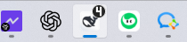
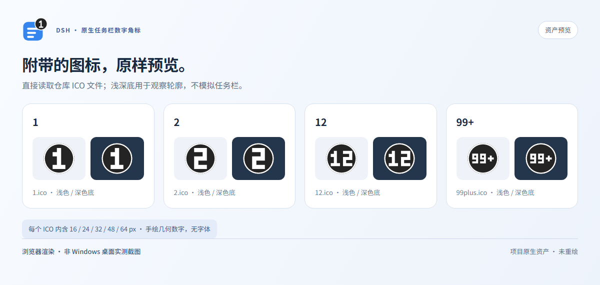

# DSH会话提醒

[English](./README.md) · [MIT 许可](./LICENSE)

**DSH会话提醒 / DSH Session Alerts** 为 DeepSeek Harness Desktop 提供**基于原生未读状态的主会话工作区筛选**，以及呈现**逐会话未读 / 待处理交互**的安静 Windows 任务栏角标。铃铛筛的是未读会话，**不是已完成任务**。

技术 npm 包名、设置命名空间和贡献 ID 继续使用 `dsh-native-taskbar-badge`；产品改名不迁移或重置设置/未读状态。

**角标样式：**0.2.2 引入原创圆润贝塞尔数字，深色圆形/胶囊底、透明抗锯齿外缘；每个 ICO 含 16/24/32/48/64 像素资产，不使用系统字体或附带字体。

## 一个会话只计一次，查看一个只减一

- **安静：**不弹窗、不响铃、不抢焦点，不修改 ASAR 或应用身份。
- **按主会话去重：**重复完成/出错事件及多个待处理请求不会重复加数，子代理不计。
- **两条限定范围的已读路径：**官方 Chat 结果页脚可确认进入视口的精确结果；客户端还会同步**当前选中、目录 ready、由主视图 retained 的主会话**：仅当原生 DSH 明确标记已读（`completionUnread === false`），且页面可见、有焦点时，才逐条确认其终态未读；不必强制滚回旧页脚。
- **精确版本校验：**两条路径均获取会话 ID、轮次、轮末事件序号和 Host 签发的未读 revision，经 CAS 确认；延迟确认不能清除更新的结果。Chat `turnTail` 标记兼容当前 `TimelineTurn` 对象及 legacy 数字形式的 `props.turn`。
- **前台仍累计：**正在查看 A 时 B 完成，B 仍加一。五个未读会话中读一个，数字为 **5 → 4**，不会全局 5 → 0；若该会话仍有待处理交互，计数可继续保留。

**没有窗口清零，也不遍历所有未读标记为 `false` 的会话批量确认。** 隐藏/失焦页面、未激活或未 retained 的会话、未知/未 ready 的原生状态，都不能触发当前会话同步。重连或刷新不会凭空产生全局 ack；两条已读路径都不清除 waiting 请求。

### Windows 真实任务栏截图——受控原生探测

| 原生探测值：5 | 原生探测值：4 |
| --- | --- |
|  |  |

*上图为 DSH 位于前台时实际捕获的 132 × 48 像素任务栏区域。同一 DSH 窗口接收原生 helper 的受控探测值 5 和 4，两次 COM 调用均成功（`HRESULT 0`）。它们证明真实 shell 绘制，不代表运行了五个真实模型任务，也不代表客户端已读确认全链路验收；5 → 4 未读状态逻辑另由隔离集成测试验证。*

<details>
<summary>历史 0.2.1 块状字对照——不是当前 0.2.2 资产，也不是桌面截图</summary>



</details>

## 数字表示什么

主会话的实时完成、出错、阻塞、输出超限结果均可计入。启用 `notifyOnWaiting` 时，未解决的审批/问题也使该会话保留计数，直到实际回答或决定；**目前没有“仅查看待回答问题即已读”的确认接口**。查看旧结果不会替你解决请求，解决请求也不会丢掉未读结果。显示 `1`～`99`，超过 99 为 `99+`。

用户取消和历史恢复不新增角标提醒；默认过滤活动目标成功的中间回合。**角标未读保存在 Host 内存中**，能跨浏览器/窗口断线、页面刷新和 helper 重启保留，**不跨 Host 重启或插件停用/重启用保留**。侧栏原生未读标记则沿用 DSH 的 **browser 生命周期**，不会从历史完成 log 凭空重建未读。不重放历史，也不承诺持久未读。详见[行为与限制](docs/behavior.zh-CN.md)。

**角标数字不等于侧栏未读行数。** 角标还统计未解决的待处理交互，旧终态未读也可在新轮运行时继续保留；原生侧栏未读是浏览器内存状态，后台 running 和生命周期差异均可能导致两者不同。当前主会话已读同步只修正特定读态差异，不代表两者完全一致。

## 工作区未读会话筛选

点击**工作区标题栏右侧、原搜索/视图/新建控件旁**的**铃铛**，仅保留原生 `ctx.uiSession.sessionStatus` 中 **`completionUnread === true`** 的未读主会话。成功/已完成、waiting、running、goal 或角标总数都不能推断未读；运行中的主会话若原生未读位为 true，仍可匹配。子代理及缺失/未知未读标记不匹配。

按钮有明确按下态和本地化可访问名称/hover：**未开启为“未读过滤”，开启为“重置条件”**。开关只保存在本页内存，与搜索、归档可见性及其他筛选**取交集**；原生会话/状态快照变化时实时更新。它不归档/删除、不写元数据、不确认未读、不清搜索、不改分组/排序，也不重置其他筛选。

空结果明确显示**“当前条件下没有未读会话。”**。“重置条件”**只关闭本铃铛筛选**，保留搜索词和其他条件；若保持开启，新到达的匹配未读会自动出现，不用再开关一次。当前会话行被筛掉也不会关闭其对话。

此功能需要**工作区扩展 API v1**，**stock rc.3 不自带**。本仓库隔离且经用户授权的[工作区 SDK 兼容工程](compat/workspace-sdk/README.md)基于 **SHA-256 固定的本地 rc.3 基线**提供真实标题栏/状态槽及可组合集合筛选；它不是上游官方已有 API 或正式发布，也刻意不打入主 npm 包。不通过 DOM 隐藏、标题猜状态、ASAR 修改或另起应用服务器实现。缺 API 时保守报告不可用，不放假按钮。

持久升级兼容包须生成修复后的包归档，固定 manifest 与 lockfile 的解析/完整性信息，再暂存并**原子替换**。不要原地改写 pnpm store 硬链接，也不能只改一次 `node_modules/.../client.js` 就称为完成升级。本机备份归档不是发布产物，不应公开发布。

铃铛**不接入完成 projection**；该投影与旧 completed helpers 仅为兼容保留，[历史完成语义](docs/completed-filter.zh-CN.md)不是当前筛选契约。[独立侧栏小包](sidebar-package/package.json)使用同一未读筛选，但不增加角标已读标记；不要与完整客户端同时启用，二者提供同一个筛选 ID。侧栏不依赖 Python 或 Windows。详见[未读筛选语义与组合](docs/unread-filter.zh-CN.md)。

**验证边界：**fake regressions 覆盖实时未读变更、搜索/归档组合、重置、当前视图 revision 竞态与 waiting 保留。个人本机 live 验证不是公开多环境 release 视觉证据；历史完成勾选截图也不能证明当前铃铛界面。

## 运行要求

**原生角标：**Windows 10/11、Explorer 与可见 DSH 任务栏按钮，已有可信 Windows **Python 3.10+**。**侧栏：**本地兼容提供的工作区扩展 API v1 及原生 `uiSession.sessionStatus`，不依赖完成投影或 Python/Windows。**Node 22+**；DSH **`>=0.2.1-rc.2 <0.3.0`**，需官方 `subprocess`、`sessionProjections`、`connection`、`webServer` 及客户端 Chat/Session/Conversation/Slot 服务。插件包通过官方插件机制附带客户端贡献；页脚已读确认仅支持 Chat，当前主会话的原生已读同步是另一条路径，遵守上文保护条件。详见[兼容说明](docs/operations.zh-CN.md)。

## 从源码安装

使用**当前 Desktop 安装自带的官方 CLI**。这是用户手动安装步骤，仓库测试不会修改现用 profile。

```powershell
$DshCli = Read-Host '本次 DSH 安装中 resources\runtime\cli\bin\dsh.cmd 的完整路径'
$Project = (Resolve-Path .).Path
& $DshCli plugin --profile desktop add --ignore-scripts $Project
```

若建立本地链接，请保留源码目录。启用前先停用其他角标提供者。安装/更新客户端贡献后，若现有页面尚未加载新贡献，请刷新原 DSH 页面。[操作与回滚](docs/operations.zh-CN.md)。

## 设置与开发

**默认简体中文，缺失翻译也回退中文。** `language: en` 为英文，仅显式 `auto` 跟随环境。自动发现失败时配置精确 `desktopExecutable` 和可信 `pythonPath`。[配置说明](docs/configuration.zh-CN.md)。

```powershell
npm run build
npm test
npm run test:python
npm run test:pack
```

已安装插件不依赖 Pillow/字体。重新生成资产及 Python 资产测试需先在开发环境运行 `python -m pip install -r tools/requirements-assets.txt`，之后离线执行；Pillow 仅限开发，不给 helper 增加依赖。测试不调用收费模型、不改现用 profile、不操作真实任务栏。[测试证据与限制](docs/verification.zh-CN.md) · [图片](docs/images.zh-CN.md) · [同类比较](docs/alternatives.zh-CN.md) · [参与开发](CONTRIBUTING.md) · [安全说明](SECURITY.md) · [资产来源](ASSET-PROVENANCE.md)。

## 许可

[MIT © 2026 O-OII contributors](./LICENSE)。
