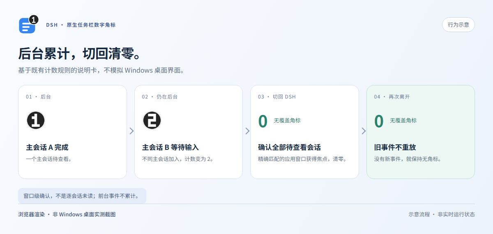

# DSH 原生任务栏数字角标

[English](./README.md) · [MIT 许可](./LICENSE)

为 DeepSeek Harness Desktop 提供安静的 Windows 原生任务栏数字角标。

## 继续手头工作，需要时再回来看

同时运行多个主会话、切到编辑器工作，让数字告诉你 DSH 是否需要关注。

- **安静提醒：**不弹窗、不响铃、不抢焦点。
- **按会话去重：**完成、出错或等待输入，同一主会话只计一次。
- **回窗即清零：**切回 DSH，一次确认全部待查看计数。
- **独立插件：**不修改 ASAR，不改应用身份。


*以上资产预览及下方行为示意均为浏览器渲染图，非 Windows 桌面实测截图。*

## 数字表示什么

DSH 在后台时，主会话完成、失败、阻塞、输出超限、等待审批或执行 `ask_user_question` 即计入；同一主会话只计一次，子代理不计。


显示 `1`～`99`，超过 99 为 `99+`。切回精确配置的 DSH exe 所属任意窗口，会清除全部待查看计数：**这是窗口级确认，不是逐会话未读系统**。前台不累计；再次离开或重启不会重放历史。



用户取消和历史恢复不提醒；默认过滤活动目标已完成的中间回合。详见[计数规则](docs/behavior.zh-CN.md)。

## 运行要求

**Windows 10/11**、Explorer 与可见 DSH 任务栏按钮；已有 Windows **Python 3.10+**；**Node 22+**；DSH **`>=0.2.1-rc.2 <0.3.0`**，需官方 `subprocess`、`sessionProjections` 服务。详见[兼容说明](docs/operations.zh-CN.md)。

## 从源码安装

克隆或下载本仓库，在源码目录打开 PowerShell。使用**当前 DSH Desktop 安装自带的官方 CLI**：

```powershell
$DshCli = Read-Host '本次 DSH 安装中 resources\runtime\cli\bin\dsh.cmd 的完整路径'
$Project = (Resolve-Path .).Path
& $DshCli plugin --profile desktop add --ignore-scripts $Project
```

若 CLI 建立本地链接，请保留源码目录。启用前先停用旧角标插件。[安装、停用与卸载](docs/operations.zh-CN.md)。

## 设置

**默认简体中文，缺失翻译也回退中文。**设 `language: en` 可用英文；仅显式 `auto` 跟随环境语言。

如未能自动找到程序，请将 `desktopExecutable` 设为精确 DSH 桌面 `.exe`、`pythonPath` 设为可信 Python 3.10+ `.exe`，均填本机已有的 Windows 绝对路径，而非 CLI 或 Node。详见[路径与设置](docs/configuration.zh-CN.md)。

## 更多

- [故障排查与回滚](docs/operations.zh-CN.md#故障排查)
- [测试与验证](docs/verification.zh-CN.md) · [图片复现](docs/images.zh-CN.md)
- [同类方案比较](docs/alternatives.zh-CN.md)
- [参与开发](CONTRIBUTING.md) · [安全说明](SECURITY.md) · [资产来源](ASSET-PROVENANCE.md)

## 许可

[MIT © 2026 O-OII contributors](./LICENSE)。
